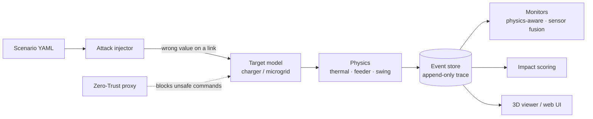

<div align="center">

# ⚡ SparkTrail

**See how a single bad number on a network wire turns into heat, overload and blackouts.**

A safe, fully simulated lab that traces a cyber event on EV-charging and microgrid
infrastructure all the way to its *physical* consequences, then replays the path in 3D.


[Quick start](#-quick-start) · [What you'll see](#-what-youll-see) · [How it works](#-how-it-works) · [Scenarios](#-scenarios) · [Project layout](#-project-layout) · [Limits](#-honest-limits)

</div>

---

## 🧭 What is this?

Modern EV chargers and microgrids are **cyber-physical systems**: software decides how much
current flows, and physics decides what happens next. If a sensor reports the wrong temperature,
or a charger is told to pull too much power, the result isn't a crashed app. Batteries heat up,
transformers overload and grid frequency drifts.

SparkTrail answers one question:

> *"If this value were wrong at this moment, what would physically happen, how fast, and would anyone notice?"*

It does that by:

1. **Modelling** chargers, batteries, feeders and microgrids with simple physics.
2. **Injecting** an abstract fault, such as *"this link reports 25 °C when the pack is really 50 °C"*.
3. **Recording** every cause → effect step as a propagation graph (the *trace*).
4. **Scoring** the physical impact and checking whether the built-in defences caught it.
5. **Visualising** the whole chain in 3D, colour-coded from root cause to cascade.

> [!IMPORTANT]
> **SparkTrail is a simulation only.** It never connects to a real charger, backend or vehicle.
> An "attack" here is just *a wrong value appearing on a modelled link at time T*. How a real
> attacker would get that access is deliberately out of scope. There are no exploits, protocols or
> device commands in this repo.

---

## 🚀 Quick start

You need **Python 3.10+**. Node.js 20+ is only needed for the web experience.

```bash
git clone https://github.com/SrijithLegend/SparkTrail.git
cd SparkTrail
pip install -r requirements.txt     # just pyyaml + networkx
```

### 1. Run your first scenario (30 seconds)

```bash
python -m sparktrail.cli scenarios/dcfast_overcurrent_tempspoof.yaml
```

You should see something like:

```text
[DC-fast overcurrent, temperature spoofed]  ->  trace.json  (11944 events)
  peak pack temp      : 57.66 C
  peak transformer    : 20.0 %
  time-to-impact      : 867.0 s
  monitor alert at    : 60.0 s
  impact score        : 26.5
```

**What just happened:** a DC fast charger was told to over-deliver current *while* its temperature
sensor was spoofed to look normal. The battery management system trusted the fake reading, so the
pack climbed to ~58 °C. The physics-aware monitor flagged the mismatch at 60 s. The full step-by-step
chain is saved in `trace.json`.

### 2. Check everything works

```bash
python test_sparktrail.py    # core engine self-checks
python test_domains.py       # multi-domain self-checks
```

Both should end with `all passed`.

### 3. Pick how you want to explore

| I want to… | Run this | Then open |
|---|---|---|
| 🖥️ **Click around a red-team console** | `pip install -r requirements-app.txt`<br>`streamlit run app.py` | the URL Streamlit prints |
| 🌐 **Watch the scroll story and live graph** | `cd sparktrail-experience`<br>`npm install && npm run dev` | http://localhost:3000 |
| 🧊 **Fly around the 3D tracer** | `python -m sparktrail.viz`<br>`cd viz3d && python -m http.server` | http://localhost:8000 |
| 🏭 **Try other industries** (water, HVAC, …) | `python -m sparktrail.domains`<br>`cd viz3d && python -m http.server` | http://localhost:8000/multidomain.html |
| 📄 **Read the landing page** | `python -m http.server` (from repo root) | http://localhost:8000/landing/ |

---

## 👀 What you'll see

### The 3D tracer (`viz3d/`)
Pick a **TARGET** (a charger or microgrid type), then an **ATTACK**. Watch pulses travel along links
as the fault spreads, with nodes heating and glowing as they overload. There are 49 pre-built
target × attack combinations, including **DEFENDED** versions where you'll see green `BLOCKED` /
`CAUGHT` stamps and `THREAT CONTAINED`.

- **Drag** to orbit · **scroll** to zoom · **click a node** to focus · `⟲` to reset
- Step / ▶ / speed controls on the transport bar
- Retro-CRT look: amber phosphor and scanlines

### The chaos console (`app.py`)
A Streamlit red-team UI. Run any scenario with or without the defensive proxy, watch the live
defence log, or hand-spoof a sensor yourself and see whether the fusion validator catches you.

### The experience site (`sparktrail-experience/`)
A Next.js scrollytelling site that walks through a charger's internals frame by frame, followed by
an attack selector, a live propagation graph and a simulator for five EV attacks.

---

## 🧠 How it works



| Piece | Where | In plain words |
|---|---|---|
| **Event store** | `core/events.py` | One append-only log. Each event says what caused it (`caused_by`), which builds a `networkx` graph of the propagation. *The trace is the product.* |
| **Targets** | `targets/` | The things being simulated: 6 charger types and 5 microgrid types. |
| **Physics** | `physics/` | Battery heating and cooling, feeder load and voltage, grid frequency (swing equation). |
| **Attacks** | `attacks/` | 9 ways a value can go wrong (see below). |
| **Monitor** | `monitor/physics_aware.py` | Runs a *different* physics model from the plant, so it can't cheat. Only alerts, never blocks. |
| **Scoring** | `scoring/impact.py` | Ranks a scenario by peak temp, load, voltage and frequency excursion, speed and nodes reached. |

### 🛡️ The four defences

1. **Zero-Trust Physics Proxy** (`control/proxy.py`). Refuses commands that are *authorised but
   physically dangerous*, and clamps them back to safe limits. Turn it on with `proxy: true` in a
   scenario.
   *Example: defended DC-fast overcurrent drops the pack from **57.7 °C → 43.2 °C**, and a defended
   mass command drops transformer load from **174 % → 104 %**.*
2. **Cross-Layer Sensor Fusion** (`monitor/sensor_fusion.py`). Checks that electrical energy in
   matches thermal energy out. A sensor held artificially low can't explain the heat, so it trips.
   An honest pack never does.
3. **Propagation depth** (`core/events.py`). Every event knows how many hops it is from the root
   attack (root 0 → impact 1 → cascade 2+), which drives the viewer's colouring.
4. **Chaos console** (`app.py`). The hands-on UI for exercising all of the above.

---

## 🧪 Scenarios

Each scenario is a small, readable YAML file in [`scenarios/`](scenarios/). Copy one and tweak it to
make your own.

| File | Target · what goes wrong |
|---|---|
| `dcfast_overcurrent_tempspoof.yaml` | DC-fast · overcurrent + temp spoof (the headline, ~57 °C) |
| `dcfast_overcurrent_defended.yaml` | Same, with the Zero-Trust proxy on |
| `cooling_suppression.yaml` | DC-fast · temp reads low, so cooling never engages |
| `ac_level1.yaml` / `ac_level2.yaml` | AC L1 / L2 · overcurrent |
| `hpc_overcurrent_tempspoof.yaml` | 350 kW HPC · overcurrent, coolant climbs (pack ~77 °C) |
| `buffered_overcurrent.yaml` | Battery-buffered · overcurrent drains the buffer |
| `v2g_forced_export.yaml` | V2G · vehicle link forced into export |
| `hub_mass_command.yaml` | Single-feeder hub · every charger to max → ~174 % transformer |
| `hub_mass_command_defended.yaml` | Same, with the proxy on |
| `hub_loadshed_suppression.yaml` | Single-feeder hub · load-shed dropped, overload pinned |
| `desync_loadshed.yaml` | Single-feeder hub · shed signal 90 s late → recurring overload |
| `lv_distribution_masscommand.yaml` | LV distribution · mass command overwhelms the PV offset |
| `depot_mass.yaml` | Fleet depot · mass command across 20 DC chargers |
| `microgrid_freq_push.yaml` | Islanded · frequency setpoint pushed to 51.5 Hz |
| `microgrid_bess_freq.yaml` | Islanded + BESS · same push, battery holds it to ~50.9 Hz |
| `microgrid_overvoltage_drift.yaml` | Islanded · voltage setpoint drifts up to ~110 % |

<details>
<summary><b>Full coverage list</b></summary>

- **6 charger types:** AC Level 1, AC Level 2, DC fast, DC ultra-fast / HPC (liquid-cooled),
  battery-buffered, bidirectional / V2G.
- **5 microgrid types:** single-feeder hub, LV distribution (with PV), islanded, microgrid with BESS,
  campus / fleet depot.
- **9 attack mechanisms:** `command_override`, `sensor_spoof`, `setpoint_drift`, `mass_command`,
  `dos_blackhole`, `replay`, `desync`, `sensor_drift`, `sensor_offset`.
- **6 entry points:** `backend_link`, `vehicle_link`, `sensor_bus`, `hub_controller`,
  `inverter_link`, `firmware_state`.
- **Physical effects:** pack temp (true vs reported), coolant temp, current, transformer load %,
  bus voltage %, frequency (nadir / peak / RoCoF), BESS state of charge, V2G export power.

</details>

<details>
<summary><b>Beyond EV charging: the multi-domain expansion</b></summary>

The same engine generalises to other operational-technology systems. Each **domain** is a set of
nodes and links, a few consequence metrics and some abstract-injection scenarios.

- **Six domains:** EV charging hub, power substation / feeder, water treatment, manufacturing robot
  cell (unoccupied), building HVAC / cold storage, pumping / pipeline station.
- **Manipulations follow MITRE ATT&CK for ICS categories:** out-of-range setpoint (T0836),
  frozen / faked sensor (T0856), mass command (T0831), suppressed protection signal (T0878),
  replay / delay (T0857).
- Each scenario is anchored to a **public incident** (Ukraine 2015/16, Oldsmar 2021, Colonial 2021, …).
- Consequences land on **process and equipment only, never people.** Human-harm cases appear only as
  a cited "Prior Occurrences" gallery, with no simulation.
- Drop a licence-clean `.glb` into `viz3d/models/<domain>/` to upgrade a node's look
  (see `viz3d/models/ATTRIBUTION.md`).

</details>

---

## 📁 Project layout

```text
SparkTrail/
├── sparktrail/              # the Python engine
│   ├── core/                #   clock, scenario loader, event store
│   ├── targets/             #   charger + microgrid models
│   ├── physics/             #   battery thermal, feeder, swing equation
│   ├── attacks/             #   attack schema + injector
│   ├── control/             #   BMS, hub controller, Zero-Trust proxy
│   ├── monitor/             #   physics-aware monitor, sensor fusion
│   ├── scoring/             #   impact score
│   ├── domains/             #   multi-domain models (water, HVAC, …)
│   ├── cli.py               #   run one scenario from the terminal
│   └── viz.py               #   build scenes.json for the 3D viewer
├── scenarios/               # ready-made attack scenarios (YAML)
├── viz3d/                   # Three.js 3D tracer (static HTML)
├── sparktrail-experience/   # Next.js scrollytelling site
├── landing/                 # static landing page
├── app.py                   # Streamlit chaos console
├── gen_attacks.py           # regenerate the web site's attack traces
├── test_sparktrail.py       # engine self-checks
└── test_domains.py          # domain self-checks
```

---

## 📖 Glossary for newcomers

| Term | Meaning |
|---|---|
| **BMS** | Battery Management System: the controller that decides how hard a battery can charge, based on its sensors. |
| **HPC** | High-Power Charger (350 kW class), usually liquid-cooled. |
| **V2G** | Vehicle-to-Grid: the car can push power *back* into the grid. |
| **BESS** | Battery Energy Storage System: a big stationary battery that steadies a microgrid. |
| **Islanded** | A microgrid running on its own, disconnected from the main grid. |
| **Swing equation** | The physics that describes how grid frequency moves when supply and demand don't match. |
| **RoCoF** | Rate of Change of Frequency: how fast the frequency moves. |
| **Trace** | The full recorded chain of events from root cause to final physical effect. |

---

## ⚖️ Honest limits

SparkTrail aims to be **directionally right, not engineering-accurate**. Every physical number in
the UI is flagged as either `modelled` (from a real model) or `illustrative` (hand-set).

- The battery is one lumped temperature, with no cell-level or spatial detail.
- The monitor shares the *form* of the plant model, so its detection times are optimistic.
- Feeder math is steady-state, and frequency uses a single-bus swing model.
- Governor and droop constants are illustrative and hand-tuned (marked in code).
- Hardware thermal cut-offs and fuses are modelled only as a firmware flag.
- Multi-domain models are first-order **archetypes**, not any real facility.

### Roadmap
- Swap in PyBaMM (battery) and pandapower (grid) behind the same `Target` interface.
- Stream live over a FastAPI WebSocket instead of replaying `scenes.json`.
- Monte-Carlo runs over ambient temperature and impedance to get an impact *distribution*.

---

<div align="center">
<sub>Built to understand cyber-physical risk, not to create it. ⚡</sub>
</div>
